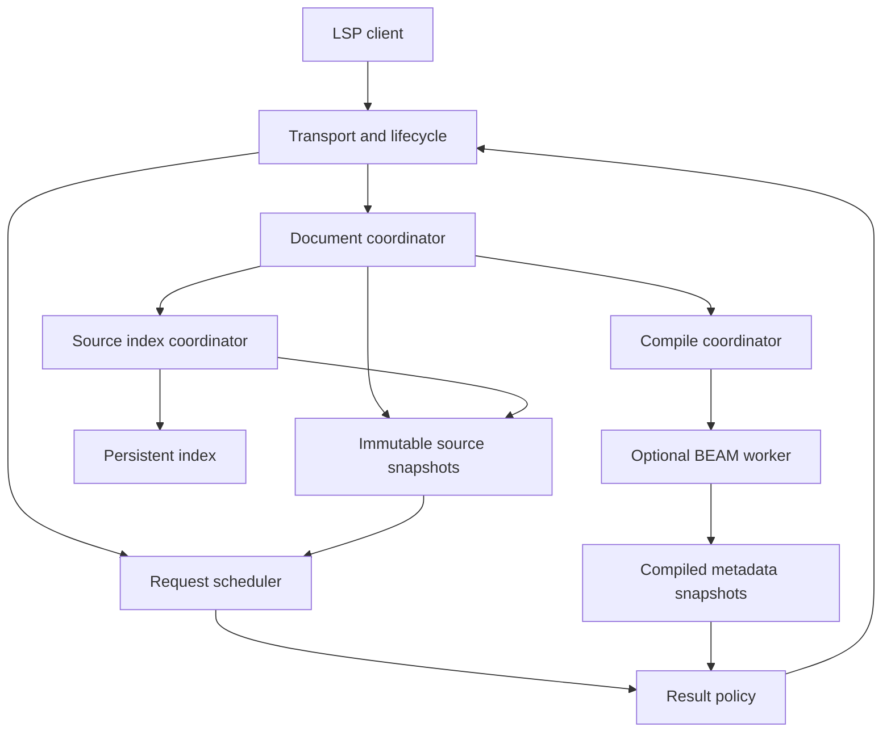

# Quicksilver architecture

## Status and authority

This document specifies the target system. The initial scaffold implements a smaller subset.
Every requirement below applies when its capability gate opens.
The roadmap defines the implementation order in [IMPLEMENTATION_PLAN.md](IMPLEMENTATION_PLAN.md).
Protocol behavior resides in [PROTOCOL.md](PROTOCOL.md).
Elixir behavior resides in [ELIXIR_SEMANTICS.md](ELIXIR_SEMANTICS.md).

| Boundary | Initial scaffold | Target system |
|---|---|---|
| Transport | Local LSP over standard input and output | Bounded concurrent request service |
| Documents | Full text synchronization | Full and incremental synchronization with immutable snapshots |
| Analysis | Tree-sitter syntax trees | Source index, scope graph, and incremental resolution |
| Features | Document symbols and syntax diagnostics | Features subject to semantic and protocol gates |
| Persistence | None | Versioned source index and compiled metadata |
| BEAM execution | None | Optional isolated worker process |
| External file changes | No completeness claim | File events, reconciliation, and explicit document ownership |

The scaffold does not establish semantic correctness, cache behavior, latency targets, or OMP integration.
The release checklist must report the exact implemented subset.
Numerical performance targets reside in [PERFORMANCE.md](PERFORMANCE.md).

## 1. System invariants

| ID | Requirement | Verification |
|---|---|---|
| ARC-001 | Source requests must not wait for compilation, a PLT, dependency retrieval, or BEAM startup. | An unavailable worker does not block source queries. |
| ARC-002 | Each request must use one immutable source snapshot. | Concurrent edits never mix source revisions inside one result. |
| ARC-003 | An open document must use the client's text. | A disk event does not replace an unsaved client buffer. |
| ARC-004 | Every compiled artifact must retain its input manifest. | Metadata from another runtime or source generation fails admission. |
| ARC-005 | Each worktree must own independent mutable state. | Two worktrees with identical module names cannot exchange project results. |
| ARC-006 | The server must state unsupported scope without a false success claim. | Unknown resolution does not become an empty complete graph. |
| ARC-007 | The server must bound queues, memory, file scans, and worker output. | Resource exhaustion produces a controlled result. |
| ARC-008 | The server must not retrieve dependencies automatically. | Missing dependencies do not cause network access or `mix deps.get`. |
| ARC-009 | Project execution must require explicit workspace authorization. | An untrusted `mix.exs` does not execute. |
| ARC-010 | A cache failure must not prevent source service. | Corrupt cache data causes isolated reconstruction. |

These requirements define availability and correctness separately.
A fast incomplete implementation does not satisfy a complete semantic capability.

## 2. Component boundaries

The request scheduler reads source snapshots without a dependency on the compile coordinator.
The result policy admits compiled metadata only after a provenance check.
No worker operation owns the document coordinator's lock.

| Component | Responsibility | Forbidden dependency |
|---|---|---|
| Transport | Frames, lifecycle, request IDs, and output order | Project compilation |
| Document coordinator | Client overlays, disk observations, and source revisions | Query execution under a mutable lock |
| Source analyzer | Syntax facts, scopes, and conservative resolution | Arbitrary Elixir execution |
| Index coordinator | File discovery, dependency invalidation, and atomic publication | LSP response output |
| Request scheduler | Snapshot capture, budgets, cancellation, and priorities | Unbounded background work |
| Result policy | Completeness, provenance, and LSP conversion | An invented confidence value |
| Compile coordinator | Project contexts, coalescence, and worker lifecycle | Source request admission |
| Worker | Authorized project execution and BEAM extraction | Direct client communication |

Rust is the implementation language.
Tree-sitter supplies syntax structure and source locations. [S1]
Salsa is an incremental query candidate, not a mandatory dependency. [S2]
The analysis interface must also support a smaller dependency engine for comparison.

## 3. Identity model

### 3.1 Workspace and worktree identity

`WorkspaceId` identifies a client workspace folder during one server session.
`WorktreeId` identifies the physical worktree and its own mutable state.
`ProjectContextId` identifies one Mix project, runtime selection, environment, and target.
`DocumentId` identifies one source object within a worktree.

ARC-011 requires identity to preserve these distinctions.
A module name, basename, branch name, or repository remote cannot identify a worktree.
Git worktrees require the resolved worktree root and resolved Git administration path.
A directory without Git uses its resolved root and filesystem identity when available.
The implementation must verify root identity before cache reuse.

The server stores both the client URI and a normalized file identity.
The original URI controls responses to that client.
Normalization must preserve URI escaping, volume rules, and platform case behavior.
The server must not lowercase paths unconditionally.
Non-file URIs support client-owned text only until a separate provider exists.

### 3.2 Symlinks and root overlap

A resolved file can have multiple client URIs.
One client connection must not create conflicting overlays for the same physical file.
The server rejects that conflict with an actionable status.
It does not select one buffer silently.

Root discovery must detect symlink cycles.
Discovery must not cross an approved workspace boundary through a symlink without an explicit inclusion rule.
An overlapping child root inherits the containing worktree identity.
Its project context can differ from its parent's context.
The longest applicable explicit project mapping resolves an overlap.
An unresolved overlap produces an ambiguous project context.

### 3.3 Mix projects and umbrella applications

Source discovery can recognize literal `mix.exs` structure without execution.
Dynamic project configuration remains unknown in source-only mode.
The server must not evaluate `mix.exs` to answer initialization or navigation requests.

An umbrella root owns one compile coordinator for each project context.
Child applications remain distinct source namespaces within that context.
The coordinator must not launch duplicate builds for every child workspace folder.
Path dependencies retain their physical identity and separate ownership permissions.
The server does not infer repository write authority from a dependency declaration.

## 4. Document ownership and external edits

### 4.1 Input precedence

| Document state | Authoritative bytes | Effect of a disk event |
|---|---|---|
| Open in the client | Latest valid `didOpen` or `didChange` text | Records disk state without replacement |
| Closed local file | Verified disk read | Creates a new source revision |
| Open virtual document | Client text | No disk interpretation |
| Closed virtual document | No retained authoritative text | Removes the active overlay |

ARC-012 requires each accepted content change to increase its internal document revision.
An LSP document version remains client-owned and distinct from that revision.
The server records a content hash for all accepted bytes.
Hash equality prevents duplicate analysis after equivalent events.

`didClose` removes the client overlay.
The coordinator then reconciles the disk object before a disk-backed query.
A deleted file becomes a tombstone in the next index generation.
A later file creation receives fresh source facts.

### 4.2 OMP disk writes

OMP can modify files outside the language server.
The server cannot infer that an open client buffer automatically contains those disk bytes.
The integration must send valid document notifications or release the client overlay before disk-driven queries.
Tests must exercise the actual OMP notification sequence.

Target file observation combines these inputs:

- Client document notifications.
- `workspace/didChangeWatchedFiles` events when the client supplies them.
- Native file observation for supported local filesystems.
- Bounded disk reconciliation after an event gap, watcher failure, or explicit refresh.

Discovery must exclude Quicksilver's own cache, worker output, and generated build trees.
Explicit inclusion rules must not create an observation loop over those owned artifacts.
Events are hints about content, not content evidence.
The coordinator reads and hashes the affected file before publication.
Atomic file replacement must produce the same result as an ordinary write.
Repeated events for identical bytes must not create repeated semantic work.

A closed-document request must refresh its target when disk freshness is uncertain.
A workspace query captures a discovery generation and reports its coverage through the result policy.
An incomplete discovery generation cannot authorize rename or complete references.
The server must not claim knowledge of external writes that no notification or read revealed.

### 4.3 Synchronization barrier

P1 and P2 must provide an internal source barrier for integration tests and disk reconciliation.
The barrier identifies changed documents and their expected content hashes.
It completes after those documents enter a published source snapshot.
It does not wait for semantic enrichment or compilation.

The optional public extension appears in [PROTOCOL.md](PROTOCOL.md).
An expected hash that conflicts with an open overlay produces a conflict result.
The barrier must not overwrite client text.

## 5. Immutable snapshots

Each request captures a `SnapshotId` after all earlier document notifications enter the coordinator.
The ID contains a session identity and a monotonic source generation.
A snapshot is a logical immutable view, not a required full copy of every file.
Shared immutable nodes and copy-on-write data can reduce memory cost.

| Snapshot field | Meaning |
|---|---|
| `snapshot_id` | Session identity and source generation |
| `workspace_manifest` | Roots, inclusion rules, exclusions, and discovery coverage |
| `document_inputs` | Document identity, source hash, client version, and ownership |
| `project_contexts` | Static project facts and context fingerprints |
| `syntax_generation` | Parser and grammar compatibility identity |
| `semantic_generation` | Analyzer schema and fact versions |
| `coverage` | Complete, partial, unsupported, or unavailable scope |
| `compiled_admissions` | References to compatible compiled snapshots |

ARC-013 requires each request to use only its captured snapshot for source reads.
Long queries retain their snapshot until completion or cancellation.
An old snapshot does not become the active snapshot again.
Memory pressure can cancel low-priority queries before snapshot reclamation.

Publication uses one atomic pointer change or an equivalent transaction boundary.
Readers see the old generation or the new generation.
They never see half of each generation.
All returned source ranges refer to the captured bytes.

## 6. Index and cache contracts

### 6.1 Storage model

The target index persists source facts, source hashes, and coverage manifests.
The active request path uses resident snapshots or explicitly budgeted reads.
Cold cache hydration runs independently from initialization.
Open documents receive priority over background project discovery.

`IndexStore` must support these operations:

- Read a complete committed generation.
- Write a candidate generation without publication.
- Atomically commit its manifest.
- Validate schema and content checksums.
- Remove obsolete generations under a retention policy.

SQLite is a storage candidate.
Its selection requires the performance and crash-recovery gates.
The interface must not depend on one database's transaction API.
Salsa memoization does not replace durable storage.

### 6.2 Invalidation axes

| Changed input | Required invalidation |
|---|---|
| Source bytes | File syntax, file facts, and dependent semantic queries |
| File addition or removal | Discovery coverage, symbol sets, and affected resolution |
| Root or inclusion rule | Workspace manifest and relevant coverage proofs |
| Parser or grammar version | Syntax artifacts and all derived facts |
| Analyzer or schema version | Incompatible semantic records |
| Elixir or OTP identity | Worker artifacts and compiled metadata |
| `mix.lock` or dependency identity | Dependency metadata and compile context |
| `MIX_ENV` or `MIX_TARGET` | Compile context and dependent enrichment |
| Compiler options or compile environment | Compile context and dependent enrichment |
| Project configuration or compile resources | Context facts and relevant compile results |
| Formatter configuration | Formatter results and applicable edits |
| Extension protocol version | Incompatible worker payloads |

ARC-014 requires conservative invalidation when a dependency is unknown.
Selective reuse needs a recorded dependency proof.
Modification time and file size alone do not prove content equality.
Environment fingerprints must not reveal raw secret values.
Cache logs must not print secret material.

### 6.3 Isolation and recovery

One writer owns each mutable worktree store.
A second process uses a separate session store or a verified read-only generation.
It must not bypass an ownership lock.
Cross-worktree sharing is limited to immutable content-addressed dependency artifacts with compatible manifests.

A failed transaction leaves the previous committed generation usable.
Corrupt records receive an isolated recovery path.
Recovery can remove Quicksilver-owned cache records only.
It must not remove project dependencies, build output, or user files.

## 7. Optional BEAM enrichment

### 7.1 Process boundary

The worker is a separate local process.
It uses the project's approved Elixir and OTP executables.
The Rust process uses local pipes for communication.
The default design exposes no TCP port and uses no Erlang distribution connection.
Worker messages follow the versioned contract in [PROTOCOL.md](PROTOCOL.md).

ARC-019 requires separation between project modules and worker control infrastructure.
Project-side helpers require a tool-controlled namespace and collision detection.
A detected collision disables the worker without a source service failure.
Tool modules must not enter project completion or reference results.

ARC-015 distinguishes process isolation from an operating-system sandbox.
A separate process limits crash and heap coupling.
It does not prevent filesystem access, network access, native code, or subprocesses.
Project compilation can execute project code. [S3]
A real sandbox requires separate platform enforcement and a verified policy.

### 7.2 Runtime discovery

The runtime selector first uses explicit executable paths.
It next considers executables from the client-provided environment.
Version files provide hints, not proof of executable identity.
The server must not source shell startup files or execute project-defined discovery commands automatically.

The selector records executable paths, reported versions, architecture, and worker compatibility.
Only tested version combinations enter the supported matrix.
An absent or unsupported runtime produces source-only service.
It does not trigger runtime installation.

### 7.3 Compile coordinator

ARC-016 permits at most one active project compilation per project context.
A burst of edits updates one pending desired generation.
The active generation can finish while the desired generation changes.
Its result retains the exact generation that it actually compiled.
The coordinator then compiles the newest desired generation, if still necessary.

The coordinator must not compile each intermediate edit.
A save event can request background work only after project execution authorization.
The worker uses its own build path and explicit environment.
It must not mutate the application's ordinary build path.
Missing dependencies produce an actionable worker state.

A compile starts from a verified input manifest.
The worker verifies relevant hashes after completion.
Concurrent disk changes invalidate the publication candidate.
An unverified compile cannot become a current compiled snapshot.
Source requests continue throughout this process.

Before-and-after hashes detect ordinary source mutation.
They do not prove an immutable or hermetic compile snapshot.
Exact snapshot claims require controlled inputs or equivalent verified read provenance.
Otherwise, the worker records observed input coverage and its limitations.
Unknown compile inputs prohibit unsupported completeness claims.

### 7.4 Compiled metadata and PLTs

Compiled enrichment includes module documentation and compiler-derived facts.
It can include declared specs, callbacks, and verified generated definitions.
The worker prefers metadata extraction that does not start project applications.
The worker must not call application entrypoints as an analysis prerequisite.

Dialyzer remains optional and separate from compilation.
ARC-017 forbids PLT work on the source request path.
A PLT cache requires its own dependency and runtime fingerprint.
Every edit must not invalidate an unchanged dependency PLT.
The implementation must distinguish a dependency PLT from project analysis results.

## 8. Scheduling, cancellation, and budgets

ARC-018 requires separate foreground and background queues.
Foreground work includes source queries and document acceptance.
Background work includes discovery, cache hydration, compilation, and optional analysis.
A background task cannot hold a foreground queue slot.

Each request receives a deadline at admission.
Its budget includes queue delay and analysis work.
The request context carries cancellation through all analysis layers.
Cancellation checks occur at bounded work intervals.
The output writer receives at most one terminal response per request.

Overload rejects or cancels bounded work with the correct protocol error.
It must not silently discard accepted requests.
Client backpressure can prevent delivery, but cannot cause unbounded memory growth.
Protocol output remains separate from logs.
Detailed response behavior resides in [PROTOCOL.md](PROTOCOL.md).

Worker processes require separate CPU, memory, and output budgets where the platform supports them.
Process budgets do not replace a security sandbox.
Performance tests must include a busy worker and concurrent source edits.

## 9. Capability gates

| Phase | Gate | Required proof |
|---|---|---|
| P0 | Scaffold audit | Exact capability report and executable protocol tests |
| P1 | Document and workspace service | Ownership, external edits, paths, encoding, lifecycle, and cancellation |
| P2 | Incremental source index | Snapshot coherence, invalidation, persistence, and crash recovery |
| P3 | Resolution and navigation | Scope fixtures, truthful unsupported states, and complete reference domains |
| P4 | BEAM enrichment | Trust controls, runtime compatibility, worker failure isolation, and provenance |
| P5 | Completion and refactors | Capability-specific completeness and edit safety |
| P6 | Release | OMP evaluation, performance budgets, compatibility matrix, and reproducible artifacts |

A later feature cannot bypass an earlier correctness gate that it depends on.
An experimental implementation remains unadvertised until its own gate passes.
[QUALITY_GATES.md](QUALITY_GATES.md) defines the release evidence.

## Sources

Sources establish external behavior. Quicksilver requirements are project decisions.

- [S1] Tree-sitter, basic parser API and source coordinates: <https://tree-sitter.github.io/tree-sitter/using-parsers/2-basic-parsing.html>
- [S2] Salsa, incremental query model: <https://salsa-rs.github.io/salsa/overview.html>
- [S3] Elixir `Code`, compilation and compiler tracers: <https://elixir.hexdocs.pm/Code.html>
- [S4] Expert, project execution and metadata architecture: <https://github.com/expert-lsp/expert/blob/main/pages/architecture.md>
- [S5] Language Server Protocol 3.17: <https://microsoft.github.io/language-server-protocol/specifications/lsp/3.17/specification/>

The compatibility matrix must pin tested runtime versions separately from these moving documentation URLs.
